# Cultivars - Models

```mermaid
---
title: Cultivars Domain Model
---
classDiagram

    CultivarCollection --> Cultivar : refers to N
    Cultivar --> AnnualLifecycleProfile : composed of one
    Cultivar --> OriginProfile : composed of one
    Cultivar --> SowingWindowsProfile : composed of one
    Cultivar --> SowingProfile : composed of one
    Cultivar --> InterplantingProfile : composed of one
    Cultivar --> GerminationProfile : composed of one
    Cultivar --> SoilProfile : composed of one
    Cultivar --> SeedProfile : composed of one
    Cultivar --> ClassificationProfile : composed of one
    Cultivar --> SizeProfile : composed of one
    Cultivar --> EcologyProfile : composed of one
    Cultivar --> CompanionsProfile : composed of one
    Cultivar --> ResistanceProfile : composed of one
    Cultivar --> HarvestProfile : composed of one
    Cultivar --> FloweringProfile : composed of one
    Cultivar --> ColorProfile : composed of one
    Cultivar --> ExpectedGeometryProfile : composed of one
    Cultivar --> WebResourceProfile : composed of one
    Cultivar --> TemperatureProfile : composed of one
    Cultivar --> IconPack : refers to at most one
    IconPack --> IconPackVariant : refers to N

    class CultivarCollection{
        name: string
        slug: string
        visibility: VisibilityEnum
        description: string
        tags: set of string
        cultivars: set of Cultivar
        parent: CultivarCollection
        user: User or none
        garden: Garden or none
    }
    class Cultivar{
        name: string
        names: set of string
        category: CultivarCategoryEnum
        tags: set of string
        abbreviation: string
        scientificName: string
        description: string
        parent: Cultivar
        iconPackId: string
        ...profiles: composed of one each of the PlantAttributeProfiles
    }
    class Range {
        min: number
        max: number
    }
    class AnnualLifecycleProfile{
        sowToGerm: Range
        germToTransplant: Range
        germToFirstHarvest: Range
        firstToLastHarvest: Range
        lastHarvestToExpiry: Range
        maturityDays: Range
        maturityBasis: MaturityBasisEnum
    }
    class OriginProfile {
        preferred: OriginEnum
        allowed: set of OriginEnum
        transplantTolerance: TransplantToleranceEnum
        transplantShockDays: number
        minNightTempToTransplant: number
    }
    class SowingWindowsProfile {
        directSeed: FrostWindows
        indoorStart: FrostWindows
        transplantOut: FrostWindows
    }
    class FrostWindows {
        lastFrost: SowingWindow
        firstFrost: SowingWindow
    }
    class SowingWindow {
        open: number
        close: number
    }
    class SowingProfile {
        sunExposure: set of SunExposureEnum
        plantingDepth: Range
        inRowSpacing: Range
        rowSpacing: Range
        thinTo: Range
        seedsPerHole: number
        successionIntervalDays: number
    }
    class InterplantingProfile {
        minimumDistance: number
    }
    class GerminationProfile {
        soilTemp: Range
        needsLight: boolean
        stratificationDays: number
        soakHours: number
    }
    class SoilProfile {
        ph: Range
    }
    class SeedProfile {
        germinationPercent: number
        seedLifeYears: number
        seedsPerMeterRow: number
    }
    class ClassificationProfile {
        family: string
        lifecycle: LifecycleEnum
        seasonType: SeasonTypeEnum
        hardinessZone: number
        difficulty: DifficultyEnum
        habit: GrowthHabitEnum
    }
    class SizeProfile {
        height: Range
        spread: Range
    }
    class EcologyProfile {
        rootDepth: Range
        rootType: RootTypeEnum
        nutrientRole: NutrientRoleEnum
    }
    class CompanionsProfile {
        beneficial: set of string
        avoid: set of string
    }
    class ResistanceProfile {
        resistances: set of string
        susceptibilities: set of string
    }
    class HarvestProfile {
        part: HarvestPartEnum
        storageDays: Range
    }
    class FloweringProfile {
        bloomDays: Range
    }
    class TemperatureProfile{
        minTemperature: number
        maxTemperature: number
    }
    class ColorProfile {
        baseColor: string
        outlineColor: string
        textColor: string
    }
    class ExpectedGeometryProfile {
        geometryType: GeometryTypeEnum
        seedSize: number
        seedlingSize: number
        firstHarvestSize: number
        lastHarvestSize: number
        expirySize: number
        enterDormancySize: number
        exitDormancySize: number
    }
    class WebResourceProfile {
        sourceUrl: string
        retrievedAt: date
        referenceUrls: set of string
    }
    class IconPack {
        name: string
        owner: User or Garden
        visibility: VisibilityEnum
        variants: set of IconPackVariant
    }
    class IconPackVariant {
        growthStage: GrowthStageEnum
        svg: string
    }
```

# Cultivar Collection

A cultivar collection groups together related Cultivars into a single package.

## visibility

If owned by a user, the HIDDEN setting will allow only that user to access the collection. If owned by a garden, the HIDDEN setting will allow only those with read-access to the garden access.

## tags

Optional metadata.

## parent

A CultivarCollection may inherit its attributes from another collection. If it does so, it inherits all Cultivars from that collection, and may override or compose on top of this collection with its own Cultivars. If a collection that is referenced by another collection is deleted, the attributes of that collection are copied before deletion: each child collection receives a copy of the deleted collection's Cultivars (except those whose names it already defines), is reparented to the deleted collection's parent, and Cultivars which were varieties of a deleted Cultivar are re-linked to the copy.

## Export and import

A collection and its Cultivars can be exported to a versioned JSON file and imported as a new collection. The format omits ids and references a Cultivar's parent by name, so an import never collides with existing data. A Cultivar whose parent is inherited from another collection is exported without its parent. The format is composed from the same schemas as the update commands, so new fields and attribute profiles are carried without changes to it.

## user and garden

A CultivarCollection is owned by a user, by a garden, or by neither. If both a user and a garden are defined, the garden owns the collection.

A collection owned by neither is a system collection. The permission rules only let a user write collections they own or administer, so nobody can change a system collection through the app: it is created and updated by a seed run with the service token, and its PUBLIC visibility lets everyone read it. The editor shows system collections read only.

## default collection

The default cultivar collection (West Coast Seeds, id `west-coast-seeds`) is a system collection. Every garden gets its own collection, "Garden cultivars", when it is created, with the default collection as its parent, so the garden resolves all of the default cultivars without a copy of them. A garden changes a default cultivar by adding a cultivar of the same name to its own collection with the default one as its parent: it wins by name and inherits everything else.

The data lives in `packages/models/src/cultivars/defaults` and is built by `tools/west-coast-seeds`. It is loaded into a database by the development seed, by `triplit seed run defaults`, and by the demo.

## priority

If the cultivar collection is in a garden, this defines its relation to other collections in the garden. Collections with higher numbers will override those with lower numbers. If two collections have the same nunmber the newest one is used.

# Cultivar

A cultivar is a container for attributes which describe a type of plant.

## name and names

`name` is the primary name: it is shown in lists and is what a Plant stores to refer to its Cultivar. `names` holds other names the plant answers to. For example, name "Zucchini" with names ["Courgette", "Summer Squash"].

Names match loosely when a Plant is resolved to a Cultivar: case, accents, and runs of spaces, hyphens and underscores are ignored, so "summer-squash", "SUMMER SQUASH" and "Summer Squash" are the same name. Plurals are not folded ("tomatoes" does not match "tomato") unless listed as a name. Every name, primary or other, must be unique within its collection once normalized, so a name can only resolve to one Cultivar there. The same name may be used in different collections, where the more child collection wins (see Cultivar Name Resolution). Other names are not inherited by child Cultivars (varieties), which would otherwise answer to the parent's names.

## category

The kind of plant: VEGETABLE, FRUIT, HERB, FLOWER, COVER_CROP or OTHER. It is set on a crop and inherited by its varieties unless they set their own. A use such as cover cropping is a tag, not a category.

## tags

Free-form labels for searching and filtering, such as `open-pollinated` or `cut-flower`. A Cultivar has its own tags and those of every parent: tags accumulate down the chain, unlike every other value, which a child replaces.

## abbreviation

A short, few character representation. Used for visual representation of plants when simple circular shapes are used. Example: "Le"

## parent

Similar to a CultivarCollection, a Cultivar can define a parent from which it inherits attributes from. The constraint is that this parent must be a Cultivar in the same CultivarCollection or in the parent collection(s). This allows describing varieties of plants.

## iconPackId _(provisional)_

An optional reference to an IconPack (see below). When set, the Layout renders this Cultivar's Plants using that pack's SVGs instead of the default colored-shape-plus-abbreviation icon. Most Cultivars won't set this - the default rendering is the permanent baseline, not a placeholder.

## profiles

The purpose of a Cultivar is to contain several different profiles which describe plant characteristics and how it interacts with the rest of the model. The idea with these profiles is that it should be easy to add more as the model grows more complex and more behaviour is required. A profile is only present on a Cultivar if something about it is known, and a child's values replace its parent's value by value.

Measurements which seed packets give as a span ("sprouts in 7-14 days", "space 45-60cm") are stored as a **Range**, `{ min, max }`, either end optional. Planning uses the midpoint, or the one end present. Lengths are in meters, temperatures in degrees Celsius, and durations in days. Sets are sets of strings, and in commands, forms and JSON they are arrays.

### Annual Lifecycle

The annual lifecycle defines the length of the stages of life for annual plants. All values are Ranges of days.

- sowToGerm: The expected amount of days from starting a seed to its germination.
- germToTransplant: The age of the seedling at transplant: the days from germination until it is ready to be moved. Unused for cultivars which cannot be transplanted.
- germToFirstHarvest: The expected amount of days from germination to the first harvest. If left unset, it is derived from the maturity days and basis (see below).
- firstToLastHarvest: The days between the first and last harvest of a plant. For plants which only have one harvest, this value is zero.
- lastHarvestToExpiry: The days from the last harvest to expiry.
- maturityDays and maturityBasis: The days to maturity as the packet states them, and what they are counted from: SOWING, GERMINATION or TRANSPLANT. They are stored as stated, because the conversion depends on how a Plant is started. When no basis is set, the Planner follows the preferred origin: SOWING if it is direct seeding, TRANSPLANT otherwise, and notes the assumption. Without a preferred origin it counts from germination.

The Planner converts the packet figure to a timeline from germination per Plant (see [Plant generation](../plants/models.md)). From SOWING, germination time is subtracted. From TRANSPLANT, the seedling age is added. A Plant which is transplanted is also set back by `transplantShockDays`. Anything it has to assume, because the Cultivar does not say, is reported with the generated history.

### Origin

The origin profile says how plants of the Cultivar can be started. The Plant's own `origin` (directSeed, seedToTransplant, seedlingToTransplant) is chosen when it is created, defaulting to the Cultivar's preferred one.

- preferred: The usual way, and the default when adding plants.
- allowed: Every way it can be started. A Cultivar which does not say allows all of them. Carrots, which do not tolerate transplants, allow only a direct seed.
- transplantTolerance: POOR, FAIR or GOOD.
- transplantShockDays: Days a transplanted plant is set back before growth resumes. Added to its time to harvest.
- minNightTempToTransplant: The lowest night temperature seedlings should be moved outdoors at.

### Sowing Windows

When a Cultivar may be started, for each way of starting it: `directSeed` (sowing seeds outdoors where the plant will grow), `indoorStart` (sowing seeds indoors, to be transplanted) and `transplantOut` (planting seedlings, started indoors or bought, outdoors). Each way has a `lastFrost` window for spring and a `firstFrost` window for fall, independent of each other, and each window is `{ open, close }` in days from that frost date, negative before it. The `close` may be left empty for a window which stays open.

The Planner turns these into [PlantingWindows](../planner/models.md#plantingwindow) for each Environment, using the Environment's frost dates. Only what a source states in relation to a frost date is recorded here: "start indoors 6-8 weeks before the last frost" is an indoor start from -56 to -42, and "direct sow after the last frost" is a direct seed open from 0.

### Sowing

How the Cultivar is sown and laid out.

- sunExposure: A set of FULL_SUN, PARTIAL_SHADE and SHADE: every exposure it grows in.
- plantingDepth: Depth to sow seeds or set transplants at. Range.
- inRowSpacing: Distance between plants within a row once established. Range.
- rowSpacing: Distance between rows. Range.
- thinTo: Distance seedlings are thinned to, when sown more closely. Range.
- seedsPerHole: Seeds sown in each spot before thinning.
- successionIntervalDays: The default days between successive sowings for a continuous harvest. A starting point which is changed when planning.

### Interplanting

A single `minimumDistance` (meters), the closest another plant may be placed to one of this Cultivar without conflict. Visualized in the Layout as a dotted line around a selected or hovered Plant (see [Planner wireframes](../planner/wireframes.md#layout)). A scalar rather than a per-Cultivar-pair table: how closely two particular plants can grow is judged from their size, roots and companion lists (see Ecology and Companions) instead.

### Germination

Conditions seeds need, beside the days it takes (in the annual lifecycle): `soilTemp` (Range), `needsLight`, `stratificationDays` (cold, moist storage before sowing), and `soakHours`.

### Soil

`ph`: the soil pH range it grows best in. Range.

### Seed

What is known about the seed: `germinationPercent`, `seedLifeYears`, and `seedsPerMeterRow` (seeds to sow one meter of row).

### Classification

- family: Botanical family, for crop rotation.
- lifecycle: ANNUAL, BIENNIAL or PERENNIAL.
- seasonType: COOL, WARM or HOT.
- hardinessZone: The coldest zone it survives winter in.
- difficulty: EASY, MODERATE or CHALLENGING.
- habit: DETERMINATE, INDETERMINATE, BUSH, POLE or VINE.

The Cultivar `parent` chain is for growing behaviour, not botany: a parent such as Bean carries only what is true of all of its members, and botanical classification lives here.

### Size

`height` and `spread` of a mature plant, as Ranges. How size changes over time is in the Expected Geometry. With no other data, the recommended spacing is a reasonable default for the mature spread.

### Ecology

How plants live alongside each other, for judging how closely they can be grown. `rootDepth` (Range), `rootType` (TAP, FIBROUS, SHALLOW or TUBEROUS), and `nutrientRole` (HEAVY_FEEDER, MODERATE_FEEDER, LIGHT_FEEDER or NITROGEN_FIXER). Plants with different root depths can share soil, tall plants shade short ones, and heavy feeders deplete what nitrogen fixers add. The Planner is intended to combine these with the size over time to work out the distance a pair needs.

### Companions

`beneficial` and `avoid`: sets of cultivar names, matched loosely like any other name.

### Resistance

`resistances` and `susceptibilities`: sets of pest and disease names.

### Harvest

`part` (LEAF, STEM, ROOT, BULB, FRUIT, FLOWER, SEED or WHOLE_PLANT) and `storageDays` (Range).

### Flowering

`bloomDays`: how long a plant stays in bloom. Range.

### Web Resource

Where the details came from: `sourceUrl`, `retrievedAt` (a date), and `referenceUrls`.

### Temperature

Not implemented yet, and deliberately kept rather than dropped: `minTemperature`/`maxTemperature` only become useful once an Environment's actual temperature is something that gets recorded, so this is waiting on Environment observations (see [Planner wireframes](../planner/wireframes.md#environment-observations)) to exist before there's anything to compare it against.

### Color

Drives the default Layout rendering of a Plant's icon (see [Planner wireframes](../planner/wireframes.md#layout)): `baseColor` fills the icon's shape, `outlineColor` strokes it, `textColor` colors the abbreviation text shown in its center. All are optional hex values; a Plant without a Cultivar color falls back to a neutral default.

### Expected Geometry

Determines the default `expectedLifespan.geometryHistory` generated for a Plant when it's created: each size is the geometry's size, in meters, at a milestone date - seed, seedling, first harvest, last harvest, expiry, and (for biennials/perennials) entering and exiting dormancy. `geometryType` picks which `Geometry` shape those milestones are expressed in. [GrowthStage](../plants/models.md#growthstage) reads the same observations at coarser granularity - its `producing` stage spans flowering through lastHarvest as one icon variant, even though geometry still sizes each of those milestones separately.

## Cultivar Name Resolution

Ultimately, all cultivars in a garden, through the garden collections and parent collections, as well as cultivars which inherit from eachother, get boiled down to a set of cultivar names that is the set of attributes that give plants behavior. Resolution happens via the following process:

1. All cultivar collections in a garden are retrieved.
2. If more than one collection is retrieved, filter to the collection with the highest priority.
3. Recursively, all parent collections of the selected garden collection and parent collections of parent collections are retrieved.
4. Retrieve all cultivars in all retrieved collections with a name or other name that loosely matches the target name.
5. Select the cultivar from the most child collection. Prefer newer cultivars and child cultivars over parents.
6. Merge selected cultivar with parents of all cultivars.

# IconPack _(provisional)_

A shareable, importable set of SVGs that a Cultivar can opt into instead of the default colored-shape-plus-abbreviation icon (see [Planner wireframes](../planner/wireframes.md#layout)). Owned by a User or a Garden and follows the same `visibility` model as CultivarCollection (HIDDEN/UNLISTED/PUBLIC).

## variants

One `IconPackVariant` per [GrowthStage](../plants/models.md#growthstage) the pack covers (`growthStage`, `svg`). A pack need not cover every stage - the Layout falls back to the default icon for any stage it doesn't provide.
