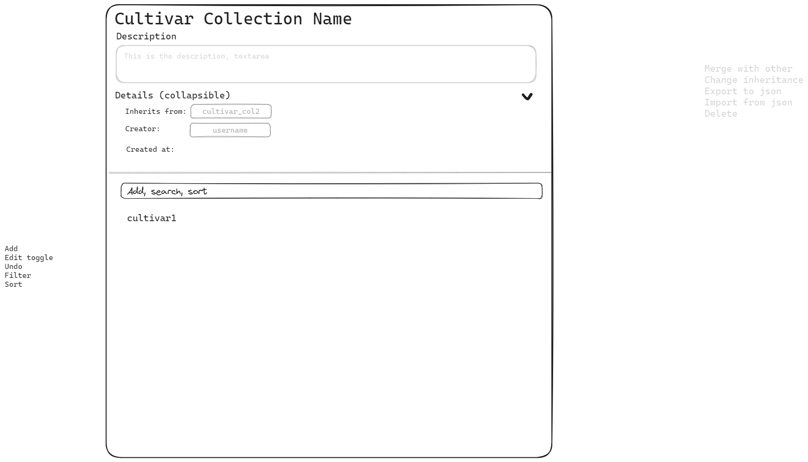

# Cultivars - Wireframes

The Cultivars wireframes allow:

- Viewing and editing CultivarCollections
- Viewing and editing the Cultivars within them

Kept deliberately simple: one master/detail page, not a wizard or a separate page per concern.

## CultivarCollections

A collection's page pairs a tree against a detail pane for whichever node is selected, with the collection's own metadata (name, slug, visibility, description, tags, parent) editable above the tree. The tree uses the same `EditableTree` pattern already built for Tree's `PlantTree`/`PlantingWindowTree`, rather than a flat list - a flat list can't represent the two inheritance hierarchies actually in play here: CultivarCollections nest under their parent collection, and Cultivars nest under their parent Cultivar (e.g. "Tomato" -> "Roma Tomato" -> "San Marzano") independently of that. A tree is the only structure that shows both without flattening one of them away.

## Cultivar detail

One flat form, not a multi-step wizard - everything about a Cultivar fits on one scrollable page:

- Top-level fields first: name, other names, category, tags, abbreviation, scientificName, description, parent, iconPackId.
- Then one collapsible section per attribute profile (see [Cultivar profiles](models.md#profiles)), collapsed by default so the page isn't a wall of fields, expanded on click. The sections and their fields are generated from the attributes update command schema (`SchemaFields.svelte`), so a new profile or field appears in the form without editing it. A Range shows as a min and a max side by side, a list of enum values as checkboxes, and a list of text values as a comma separated field.

Every field - top-level or inside a profile section - uses the same `Form.Label`/`FormInfoPopover` pattern already built for this exact purpose elsewhere in the app (see `PlantsCreateFormModeSingle.svelte`): a small info icon next to the label that reveals that field's description on click, sourced from the same Zod `.describe()` text already written for each field in `packages/models`. This was chosen over inline help text specifically because it's already built, already used elsewhere, and keeps the form scannable at a glance while still putting every parameter's meaning one click away - not because anything about editing Cultivars needs a new explanation pattern of its own.

## Inherited collections

The tree also shows the collections the garden's own collections inherit from, such as the default West Coast Seeds collection, with their cultivars. They are read only: the detail pane is disabled, and a banner explains it. For a cultivar, an "Override in my collection" button opens the create form in the garden's collection with the same name and the inherited cultivar as its parent, so the garden's version wins by name and keeps inheriting everything else. Deleting is not offered for inherited collections or cultivars, and "Add cultivar" always adds to the garden's own collection.
