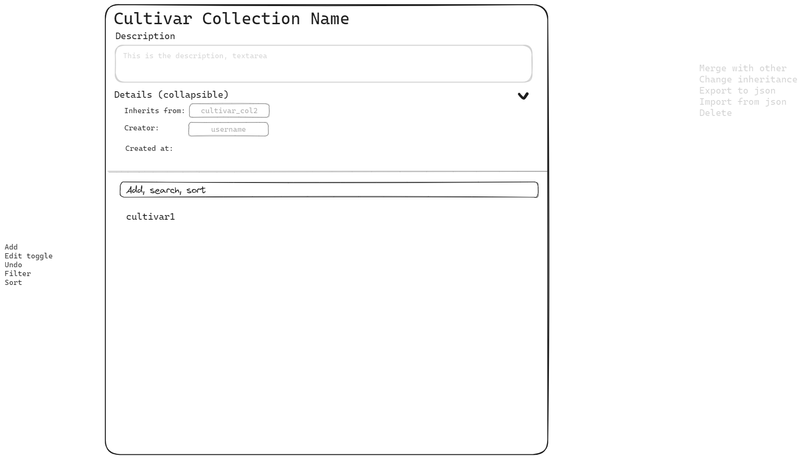

# Cultivars - Wireframes

The Cultivars wireframes allow:

- Viewing and editing CultivarCollections
- Viewing and editing the Cultivars within them

Kept deliberately simple: one master/detail page, not a wizard or a separate page per concern.

## CultivarCollections

A collection's page pairs a tree against a detail pane for whichever node is selected, with the collection's own metadata (name, slug, visibility, description, tags, parent) editable above the tree. The tree uses the same `EditableTree` pattern already built for Tree's `PlantTree`/`PlantingWindowTree`, rather than a flat list - a flat list can't represent the two inheritance hierarchies actually in play here: CultivarCollections nest under their parent collection, and Cultivars nest under their parent Cultivar (e.g. "Tomato" -> "Roma Tomato" -> "San Marzano") independently of that. A tree is the only structure that shows both without flattening one of them away.

## Cultivar detail

One flat form, not a multi-step wizard - everything about a Cultivar fits on one scrollable page:

- Top-level fields first: names, abbreviation, scientificName, description, parent, iconPackId.
- Then one collapsible section per attribute profile (Annual Lifecycle, Frost Date Planting Windows, Origin, Color, Expected Geometry, Interplanting - [Temperature](models.md) excluded for now since it doesn't appear to be implemented), collapsed by default so the page isn't a wall of fields, expanded on click. The sections and their fields are generated from the attributes update command schema (`SchemaFields.svelte`), so a new profile or field appears in the form without editing it.

Every field - top-level or inside a profile section - uses the same `Form.Label`/`FormInfoPopover` pattern already built for this exact purpose elsewhere in the app (see `PlantsCreateFormModeSingle.svelte`): a small info icon next to the label that reveals that field's description on click, sourced from the same Zod `.describe()` text already written for each field in `packages/models`. This was chosen over inline help text specifically because it's already built, already used elsewhere, and keeps the form scannable at a glance while still putting every parameter's meaning one click away - not because anything about editing Cultivars needs a new explanation pattern of its own.
